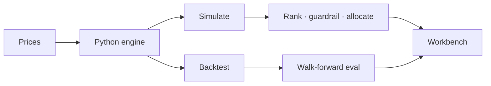

# Monte Carlo

Monte Carlo simulation and walk-forward validation for portfolio decisions. A Python engine with auditable price provenance, exposed through a CLI and a Next.js workbench. Built for one job: decide whether a strategy deserves capital, with evidence.



## Quickstart

```bash
python3 -m pip install -e .
npm install
npm run dev
```

Open `http://localhost:3000`.

## CLI

```bash
# Simulation
monte-carlo simulate AAPL MSFT --days 252 --scenarios 5000 --seed 42

# Walk-forward backtest
monte-carlo backtest AAPL MSFT --lookback 60 --hold 20 --rebalance 20

# Offline fixtures
monte-carlo simulate AAPL --source offline --data-path sample_data

# Decision-stability gate before capital is risked
monte-carlo evaluate evaluation_sets/sample-stability.json --output results/evaluation
```

`evaluate` gates a decision across seeds and models before capital is risked. The reference manifest and `sample_data/` are source-checkout assets and are not included in the installed wheel. Wheel users must supply their own evaluation-set JSON and local data paths.

## What it does

- **Simulation.** Multi-asset Monte Carlo with configurable scenarios, horizons, and seeds. Ranked output with guardrails before any allocation.
- **Walk-forward backtesting.** Lookback, hold, and rebalance windows. No lookahead bias: parameters fit only on data the strategy could have seen.
- **Decision stability.** The `evaluate` command runs a candidate decision across seeds and model variants and reports whether the conclusion holds. Unstable decisions fail the gate.
- **Auditable provenance.** Every price input carries its source. `auto`, `offline`, or `online`. Local CSVs need `Date` and `Close`. Fixtures live in `sample_data/`.

## Architecture

| Layer | Role |
| --- | --- |
| `app/` | Next.js App Router and `/api/run` |
| `components/workbench/` | Browser UI |
| `lib/` | Types and Python bridge |
| `ui_bridge.py` | JSON bridge for the API route |
| `ui_state.py` | Presentation state builder |

**Deploy:** Vercel-ready. See [docs/deploy.md](docs/deploy.md).

## Test

```bash
pytest -q
npm run typecheck
npm run build
```

MIT · [LICENSE](LICENSE)
